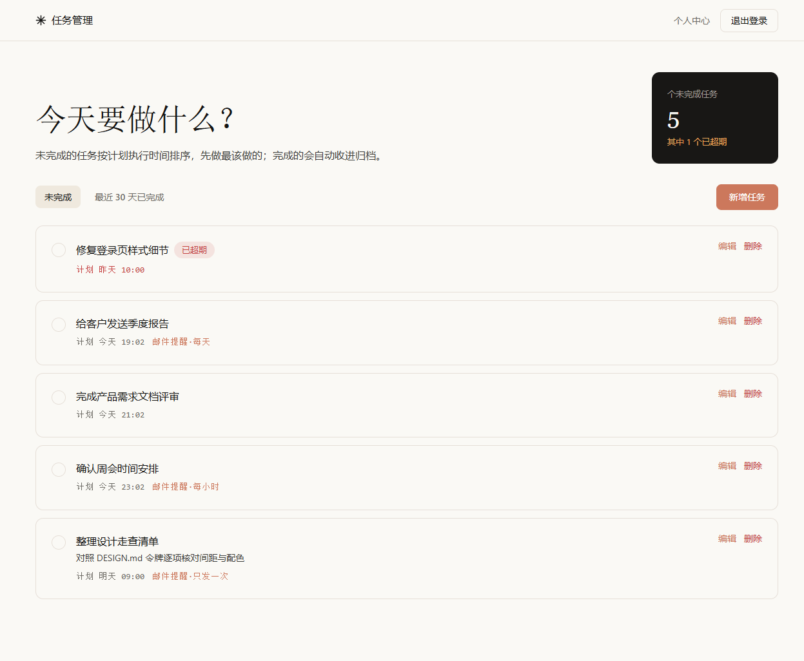
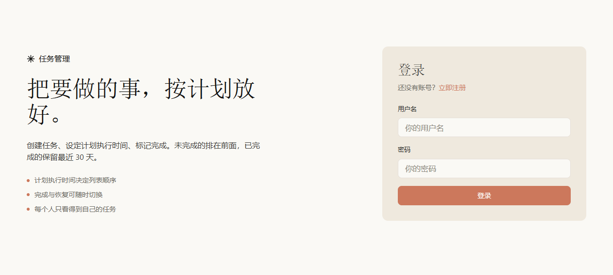
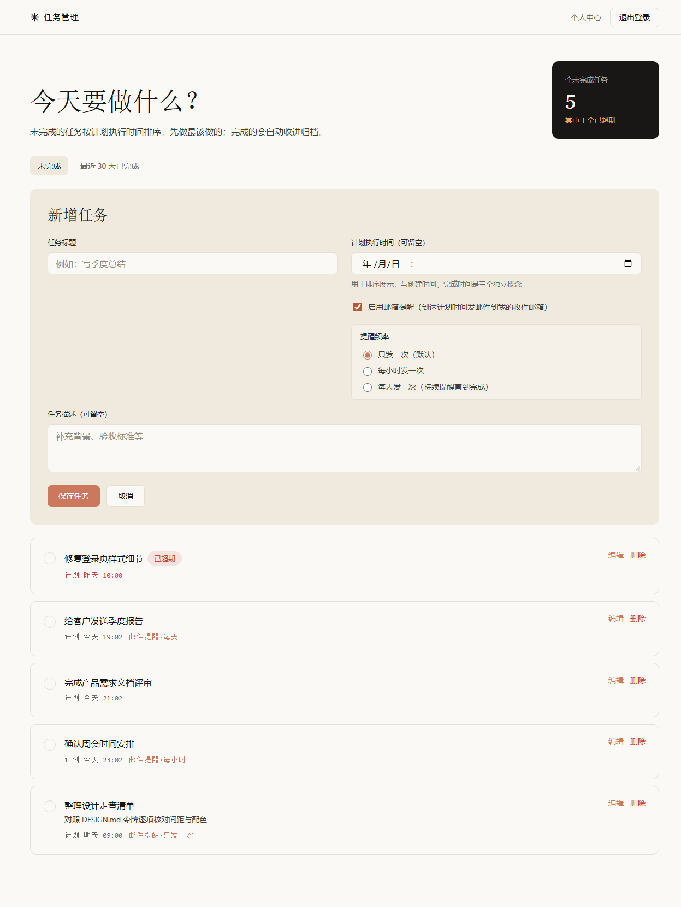
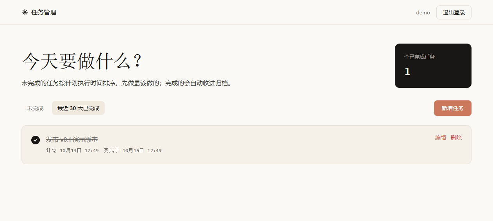
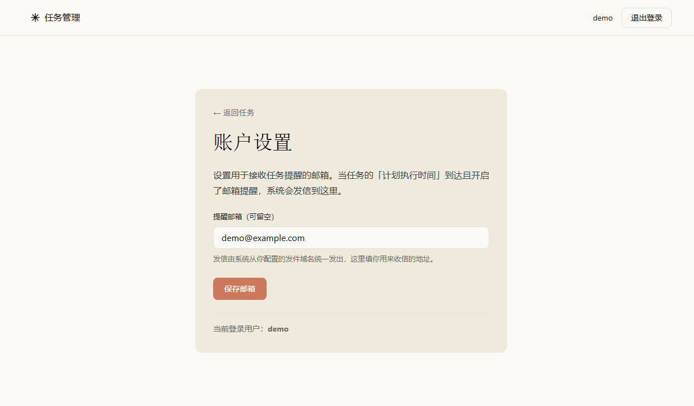
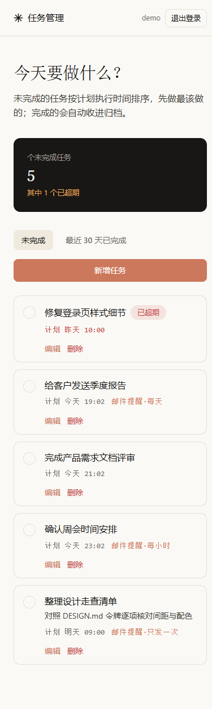
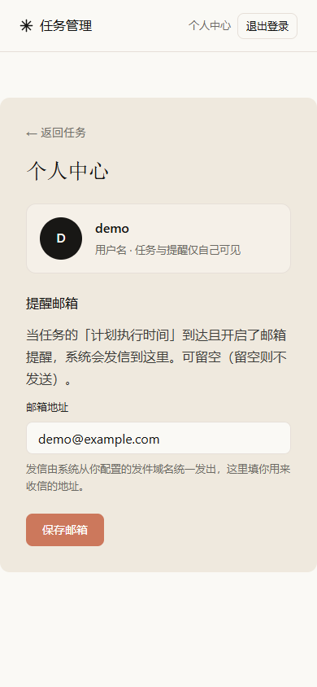

<div align="center">

# 🗂️ 任务管理系统 · Task Management System

**把要做的事，按计划放好。** 注册登录 → 创建任务 → 按计划时间查看 → 标记完成，到点自动发邮件提醒。


</div>

---

前后端分离的个人 / 小团队任务管理系统（**FastAPI + Vue 3 + MySQL 8**）。以「**计划执行时间**」驱动待办排序，支持**邮箱提醒**（只发一次 / 每小时 / 每天），并用 **Docker 一条命令**完成部署。

<p align="center"></p>

## ✨ 功能特性

- 🗂️ **计划驱动** — 用「计划执行时间」给待办排序，先做最该做的；未完成的在前，已完成的自动归档（保留最近 30 天）。
- ⏰ **邮箱提醒** — 到达计划时间自动发信到你设置的邮箱；频率可选「只发一次 / 每小时一次 / 每天一次」，发送失败会自动重试。
- 🔐 **安全** — Argon2id 密码哈希、JWT 鉴权、越权防护（别人的任务一律按 404 处理）。
- 🐳 **一键部署** — 多阶段 Docker 镜像，后端同时托管前端页面，`docker compose up -d` 即可使用。
- 🎨 **清爽界面** — Vue 3 + 设计令牌，超期高亮、完成态删除线、移动端自适应。
- 📱 **手机可用** — 响应式布局，手机 / 平板浏览器直接打开即可完整使用（含设置提醒邮箱）。

## 📸 界面预览

| 登录 | 新增任务（提醒频率） |
|:---:|:---:|
|  |  |

| 已完成 | 账户设置（提醒邮箱） |
|:---:|:---:|
|  |  |

### 📱 移动端

响应式布局，手机 / 平板浏览器直接打开即可使用（任务列表、新增任务、设置页均已适配，无需额外 App）：

| 移动端 · 任务列表 | 移动端 · 账户设置 |
|:---:|:---:|
|  |  |

## 🚀 快速开始

**Docker（推荐，一条命令）：**

```bash
git clone https://github.com/chuling-lingling/Task-Management-System.git
cd Task-Management-System
cp .env.example .env        # 填写 JWT_SECRET_KEY（openssl rand -hex 32）与 SMTP_*
docker compose up -d --build
# 浏览器打开 http://localhost:8000
```

> 不想用 Docker？下方「本地启动」用于开发，「部署到 Linux 服务器」用于生产裸机部署，两种路径二选一。

## 技术栈

后端：FastAPI 0.116 · Uvicorn · SQLAlchemy 2.0 · PyMySQL · Pydantic v2 · PyJWT · Argon2id
数据库：MySQL 8
前端（M5 起）：Vue 3 + Vite + Pinia + Axios

## 目录结构

```
task-system/
├── .env / .env.example     环境变量（.env 已忽略入库）
├── requirements.txt        后端依赖
├── AGENTS.md               工程约定，改代码前请先阅读
├── backend/app/
│   ├── main.py             应用入口、CORS、路由注册、lifespan 后台任务
│   ├── core/               config / security / errors（基础设施）
│   ├── db/                 base / session（引擎与会话）/ migrate（自愈式加列）
│   ├── models/             ORM 模型，一张表一个文件
│   ├── schemas/            Pydantic 入参出参
│   ├── services/           email（SMTP 发送）/ reminder（到期扫描）
│   └── api/                deps（鉴权依赖）、v1/（按资源拆分路由）
├── frontend/               M5 起启用
├── scripts/                init_db.py / send_reminders.py / migrate_email.py / smoke*.py
```

依赖方向严格单向：`api → schemas → models → db`，`core` 作为被复用的工具层。详细约定见 `AGENTS.md`。

## 本地启动

### 1. 创建并激活虚拟环境

Windows（PowerShell）：

```powershell
python -m venv .venv
.\.venv\Scripts\Activate.ps1
```

Windows（Git Bash）：

```bash
python -m venv .venv
source .venv/Scripts/activate
```

Linux / macOS：

```bash
python3 -m venv .venv
source .venv/bin/activate
```

### 2. 安装依赖

```bash
pip install -r requirements.txt
```

### 3. 配置环境变量

```bash
cp .env.example .env
```

编辑 `.env`，重点填写这几项：

| 变量 | 说明 |
|---|---|
| `MYSQL_HOST` / `MYSQL_PORT` | MySQL 地址与端口 |
| `MYSQL_USER` / `MYSQL_PASSWORD` | 数据库账号密码 |
| `MYSQL_DB` | 数据库名，默认 `task_system` |
| `JWT_SECRET_KEY` | JWT 签名密钥，生产环境务必替换为随机值 |
| `CORS_ORIGINS` | 允许的前端来源，逗号分隔 |
| `SMTP_HOST` / `SMTP_PORT` | 发件 SMTP 服务器地址与端口（SSL 常用 465） |
| `SMTP_USER` / `SMTP_PASSWORD` | 发件账号与授权码（用你的域名邮箱，如 `noreply@你的域名`） |
| `SMTP_FROM_NAME` | 收件人看到的发件人显示名 |
| `SMTP_USE_SSL` | `true` 走 SSL（465），`false` 走 STARTTLS（587） |
| `FRONTEND_URL` | 提醒邮件正文里指向的前端地址 |
| `REMINDER_INTERVAL_SECONDS` | 后台定时扫描间隔（秒），默认 60 |
| `ENABLE_REMINDER_WORKER` | 是否启用内置后台定时任务，多 worker 部署时设 `false` |

`JWT_SECRET_KEY` 可用任意随机串生成，例如：

```bash
openssl rand -hex 32
```

### 4. 初始化数据库

确保 MySQL 服务已启动，然后执行：

```bash
python scripts/init_db.py
```

脚本会自动创建 `MYSQL_DB` 指定的数据库（需要 CREATE DATABASE 权限），再建 `users` 和 `tasks` 两张表，建完还会逐表做一次探测查询。

已存在的表不会被改动。后续新增的字段（如 M7 的邮箱与提醒列）由应用**启动时自动补齐**：`app/db/migrate.py` 的 `ensure_email_columns()` 会查询 `information_schema`，缺列才 `ALTER TABLE` 补上，可重复执行、幂等。也可手动跑 `python scripts/migrate_email.py`。

### 5. 启动后端

在项目根目录执行：

```bash
python -m uvicorn app.main:app --app-dir backend --reload --host 127.0.0.1 --port 8000
```

参数 `--app-dir backend` 用于把 `backend` 加入模块搜索路径，不能省略。

### 6. 启动前端

另开一个终端：

```bash
cd frontend
npm install --ignore-scripts
npm run dev
```

打开 <http://localhost:5173>。开发服务器已把 `/api` 代理到 `http://127.0.0.1:8000`，前端不需要额外配置后端地址。

> `--ignore-scripts` 是必需的。Windows 下 esbuild 的 postinstall 校验脚本会 spawn 失败并触发 npm 回滚，把已装好的平台二进制一起删掉，导致 Vite 启动报「The package could not be found」。
>
> 如果启动时仍报找不到 esbuild / rollup 原生模块，补装两个平台包即可：
>
> ```bash
> npm install --save-optional --ignore-scripts --registry=https://registry.npmmirror.com \
>   "@esbuild/win32-x64@0.25.12" "@rollup/rollup-win32-x64-msvc@4.64.6"
> ```

生产构建：`npm run build`，产物在 `frontend/dist/`。

### 7. 一键冒烟

后端启动后，在项目根目录执行：

```bash
python scripts/smoke.py
```

会先探活 `/health`，再依次跑认证与任务两套端到端检查（共 72 项），最后汇总。也可以单独跑：

```bash
python scripts/smoke_auth.py     # 认证 25 项
python scripts/smoke_tasks.py    # 任务 47 项
```

## 部署到 Linux 服务器

面向 Ubuntu 22.04 / 24.04 等。需要 **Python 3.11+**、**Node 18+**、**MySQL 8**。

> 本项目后端在检测到 `frontend/dist` 存在时会**自动托管前端静态文件并兼做 SPA 路由回退**，所以无需单独部署 nginx 来伺服前端——一个后端进程同时提供 API 与页面。

### 1. 拉取代码

```bash
git clone <你的仓库地址> task-system
cd task-system
```

### 2. 准备 Python 后端

```bash
python3 -m venv .venv
source .venv/bin/activate
pip install -r requirements.txt
```

### 3. 准备 MySQL

登录 MySQL，建库并建一个专用账号（不要让应用直连 root）：

```sql
CREATE DATABASE task_system CHARACTER SET utf8mb4;
CREATE USER 'taskapp'@'127.0.0.1' IDENTIFIED BY '换成强密码';
GRANT ALL PRIVILEGES ON task_system.* TO 'taskapp'@'127.0.0.1';
FLUSH PRIVILEGES;
```

### 4. 配置 .env

```bash
cp .env.example .env
```

编辑 `.env`，**生产环境务必改掉以下项**：

| 变量 | 生产建议 |
|---|---|
| `MYSQL_HOST` / `MYSQL_USER` / `MYSQL_PASSWORD` / `MYSQL_DB` | 填第 3 步建的库与账号 |
| `JWT_SECRET_KEY` | `openssl rand -hex 32` 生成随机值，**绝不能用默认值、绝不能留空** |
| `APP_ENV` | 设为 `production` |
| `CORS_ORIGINS` | 填站点地址（前后端同域时其实不需要跨域，可留空或填站点自身） |
| `FRONTEND_URL` | 提醒邮件里指向的前端地址，如 `https://你的域名` |
| `SMTP_*` | 填你的发件服务（详见下方「邮件提醒」章节的 DNS 配置） |

初始化表结构（也会按需建库）：

```bash
python scripts/init_db.py
```

### 5. 构建前端

```bash
cd frontend
npm install --ignore-scripts
npm run build      # 产物在 frontend/dist/
cd ..
```

### 6. 启动后端（API + 前端一站托管）

单进程即可同时提供 API 与前端页面：

```bash
source .venv/bin/activate
uvicorn app.main:app --app-dir backend --host 127.0.0.1 --port 8000
```

并发较高时多开 worker（数量可取 CPU 核数）：

```bash
uvicorn app.main:app --app-dir backend --host 127.0.0.1 --port 8000 --workers 4
```

> 单进程部署时 `ENABLE_REMINDER_WORKER` 保持 `true`（默认）；若用 `--workers N` 多进程，请把它设为 `false`，改用 cron 周期调用 `python scripts/send_reminders.py` 发送提醒，避免多个进程重复发信。

### 7. 开机自启（systemd）

新建 `/etc/systemd/system/task-system.service`：

```ini
[Unit]
Description=Task System Backend
After=network.target mysql.service

[Service]
WorkingDirectory=/opt/task-system
ExecStart=/opt/task-system/.venv/bin/python -m uvicorn app.main:app --app-dir backend --host 127.0.0.1 --port 8000 --workers 4
Restart=always
User=www-data
Environment=PYTHONUNBUFFERED=1

[Install]
WantedBy=multi-user.target
```

```bash
sudo systemctl daemon-reload
sudo systemctl enable --now task-system
```

### 8. 对外暴露 + HTTPS（推荐 nginx 反代）

不绑域名时，访问 `http://服务器IP:8000` 即可直接使用。要绑域名并上 HTTPS，在 nginx 做反代即可：

```nginx
server {
    listen 80;
    server_name 你的域名;
    location / {
        proxy_pass http://127.0.0.1:8000;
        proxy_set_header Host $host;
        proxy_set_header X-Real-IP $remote_addr;
    }
}
```

用 `certbot --nginx` 申请证书后即可走 HTTPS；此时把 `.env` 的 `CORS_ORIGINS` 与 `FRONTEND_URL` 改为 `https://你的域名`。

### 9. 后续升级

```bash
cd /opt/task-system
git pull
source .venv/bin/activate
pip install -r requirements.txt
cd frontend && npm install --ignore-scripts && npm run build && cd ..
sudo systemctl restart task-system
```

应用启动时会自动补齐新增列（自愈式迁移），无需手动改表。

## 用 Docker 一键部署（推荐）

不想装 Python/Node/MySQL 环境，直接一条命令起整套。**数据库也自动包含在内**：compose 会拉起一个 MySQL 8 容器（数据持久化到 `db_data` 卷），后端首次启动自动建表，无需单独安装/配置 MySQL。同时后端直接托管前端页面：

```bash
# 1. 准备环境配置（JWT 密钥、SMTP 等；DB 账号由 compose 管理，不用改）
cp .env.example .env
# 编辑 .env：填 JWT_SECRET_KEY（openssl rand -hex 32）与 SMTP_*，可选填 FRONTEND_URL/CORS_ORIGINS

# 2. 一键拉起（首次会构建镜像，稍等片刻）
docker compose up -d --build

# 3. 访问 http://localhost:8000
```

- 镜像用多阶段构建：先 `node:22-slim` 构建前端，再 `python:3.13-slim` 运行后端，前端静态文件直接打进后端镜像，所以**不需要额外 nginx 伺候前端**。
- 后端容器启动时会先幂等建表（`scripts/init_db.py`）再启动 uvicorn；MySQL 通过 `depends_on + healthcheck` 确保就绪后才连。
- 数据落在名为 `db_data` 的卷里，容器重建不丢；删库重来：`docker compose down -v`。
- 想绑域名 + HTTPS：把 `.env` 的 `FRONTEND_URL`、`CORS_ORIGINS` 改成你的域名，再用 nginx/caddy 在宿主机反代 `localhost:8000` 并申请证书即可（后端本身无需改动）。
- 看日志：`docker compose logs -f backend`。

> 若宿主机已有 MySQL 或想拆开部署，仍可走上一节「部署到 Linux 服务器」的手动方式；Docker 与手动两种路径二选一。

## 验收方法

### M1 骨架与配置

1. `GET http://127.0.0.1:8000/health` 返回 `{"status":"ok","env":"development"}`
2. 浏览器打开 <http://127.0.0.1:8000/docs> 能看到 Swagger 文档
3. 虚拟环境可激活，且 `pip list` 中能看到 fastapi、sqlalchemy、pymysql、PyJWT、argon2-cffi

### M2 数据层

1. `python scripts/init_db.py` 输出"全部表可读，初始化成功"
2. 在 MySQL 客户端执行以下命令，两张表的字段应与预期一致：

```sql
USE task_system;
DESC users;
DESC tasks;
SHOW INDEX FROM tasks;
```

预期结果：`tasks` 存在 `(user_id, completed_at)` 复合索引、`user_id` 外键指向 `users.id`；`users.username` 唯一。

### M3 认证模块

后端启动后执行：

```bash
python scripts/smoke_auth.py
```

脚本会覆盖：注册成功、重复注册返回 409、弱密码与非法用户名返回 422、未携带令牌返回 401、伪造/篡改令牌返回 401、密码错误返回 401、用户名不存在与密码错误返回同一文案、登录成功并携带令牌访问 `/me`。

期望输出：`通过 25 项，失败 0 项`。脚本使用随机用户名，可重复执行。

也可以在 Swagger 里手动点：先调 `/api/v1/auth/register`，再调 `/api/v1/auth/login` 拿到 `access_token`，点右上角 Authorize 填入后调 `/api/v1/auth/me`。

### M4 任务模块

后端启动后执行：

```bash
python scripts/smoke_tasks.py
```

覆盖：未登录与伪造令牌访问全部任务接口返回 401、创建任务、纯空白标题与超长标题返回 422、
默认排序（计划时间升序、无计划时间排最后）、修改标题时 `created_at` 不变而 `updated_at` 刷新、
完成时间不可通过修改接口伪造、完成与恢复、重复标记幂等、已完成任务不出现在默认列表、
40 天前完成的任务不出现在已完成列表、他人读写删一律 404、删除后再访问 404。

期望输出：`通过 47 项，失败 0 项`。

### M5 前端界面

前后端都启动后，浏览器打开 <http://localhost:5173>，按下面顺序操作：

1. 未登录时访问 `/` 会被重定向到登录页。
2. 点「立即注册」注册一个新账号，成功后自动进入任务界面。
3. 点「新增任务」，分别创建：一条带计划时间（较早）、一条带计划时间（较晚）、一条不填计划时间。确认列表顺序为「较早 → 较晚 → 未填」，与后端排序规则一致。
4. 点任务左侧圆形勾选框标记完成，任务从列表消失；切到「最近 30 天已完成」标签可以看到它，显示完成时间。
5. 在已完成标签里再点一次勾选框恢复未完成，任务回到未完成列表。
6. 点「编辑」修改标题、描述、计划时间，保存后列表立即更新。
7. 点「删除」，按钮变为「确认删除 / 取消」，确认后任务消失。
8. 把某条任务的计划时间设为过去，列表里会出现「已超期」红色标记。
9. 点右上角「退出登录」，应回到登录页；直接访问 `/` 也会被拦回登录页。
10. 刷新页面（F5），登录状态应保留。

## 前端说明

技术栈：Vue 3（`<script setup>`）+ Vite + Pinia + Vue Router + Axios。

```
frontend/src/
├── api/          http.js（axios 实例与统一错误处理）、auth.js、tasks.js
├── stores/       auth.js（登录态，令牌持久化到 localStorage）
├── router/       index.js（路由与登录守卫）
├── views/        LoginView、RegisterView、TasksView、SettingsView
├── components/   AppHeader、TaskForm、TaskItem、TaskFilterTabs、EmptyState、BrandMark
├── styles/       tokens.css（DESIGN.md 令牌）、base.css（基础元素样式）
└── utils/        datetime.js（计划时间/完成时间的展示与格式化）
```

**视觉规范**：所有颜色、字号、圆角、间距都取自 `DESIGN.md`，集中定义在 `frontend/src/styles/tokens.css`，组件内不硬编码色值。字体使用**本地字体栈**（显示级标题 Georgia/宋体系衬线、正文系统无衬线），不引入外部字体服务——外部字体在不可达网络下会阻塞首次渲染导致白屏。若本机装有 Cormorant Garamond / EB Garamond / Inter 会自动优先使用，更贴近 DESIGN.md 的原始字体气质。

**登录态**：令牌存 `localStorage`，axios 请求拦截器自动附加 `Authorization: Bearer <token>`；响应拦截器遇到 401 会清空登录态并跳回登录页（登录/注册接口自身的 401 除外）。

**错误提示**：后端返回的 `{detail, code}` 与 422 的字段级错误都会被 `api/http.js` 归一化成一句可直接展示的中文提示。

## 认证接口

| 方法 | 路径 | 说明 | 成功状态码 |
|---|---|---|---|
| POST | `/api/v1/auth/register` | 注册，用户名 3-32 位且限字母数字下划线，密码 8-64 位 | 201 |
| POST | `/api/v1/auth/login` | 登录，返回 `access_token` / `token_type` / `expires_in` / `user` | 200 |
| GET | `/api/v1/auth/me` | 获取当前登录用户，需 Bearer 令牌 | 200 |
| PATCH | `/api/v1/auth/me` | 更新当前用户收件邮箱（可传 `null` 清空），需 Bearer 令牌 | 200 |

请求头格式：`Authorization: Bearer <access_token>`。令牌默认有效期 7 天（`JWT_EXPIRE_DAYS` 可调）。

**安全实现要点**：

- 密码用 Argon2id 哈希入库，库里存的是 `$argon2id$v=19$m=65536,t=3,p=4$...` 形态，响应体从不包含 `password_hash` 字段。
- 用户名不存在时，服务端仍会执行一次等价的哈希运算再返回，避免通过响应时间差枚举出已注册用户名。
- 所有未捕获异常对外只返回 `{"detail":"服务器内部错误，请稍后重试","code":"internal_error"}`，堆栈进服务端日志，不泄漏连接串等信息。

**错误响应结构**：`{"detail": "提示文案", "code": "机器可读码"}`。已定义的 code：`username_taken`、`invalid_credentials`、`not_authenticated`、`token_invalid`、`token_expired`、`user_not_found`、`internal_error`、`validation_error`。

## 任务接口

全部需要 Bearer 令牌。所有查询都强制带 `user_id` 维度，别人的任务一律返回 404。

| 方法 | 路径 | 说明 | 成功状态码 |
|---|---|---|---|
| GET | `/api/v1/tasks` | 默认返回未完成任务 | 200 |
| GET | `/api/v1/tasks?status=done` | 返回最近 30 天内完成的任务 | 200 |
| POST | `/api/v1/tasks` | 创建任务，可带 `email_reminder_enabled` | 201 |
| PATCH | `/api/v1/tasks/{id}` | 修改标题/描述/计划执行时间/`email_reminder_enabled` | 200 |
| PATCH | `/api/v1/tasks/{id}/completion` | `{completed: true\|false}` 完成或恢复 | 200 |
| DELETE | `/api/v1/tasks/{id}` | 删除自己的任务 | 204 |

**排序规则**

- 未完成任务：`planned_at` 升序，未设置计划时间的排最后，组内按 `created_at` 倒序。
- 已完成任务：按 `completed_at` 倒序，且只取最近 30 天。

**约束说明**

- `completed_at` 不接受客户端写入：修改接口只认 `title`、`description`、`planned_at`，完成时间只能由 `/completion` 接口写入当前时刻。重复标记完成不会覆盖首次完成时间。
- 标题首尾空白会被去掉，纯空白标题返回 422；描述为空串时归一化成 `null`。
- `email_reminder_enabled`：是否启用邮箱提醒，**默认 false**。注意——修改 `planned_at` 或 `email_reminder_mode` 会重置发送标记，使提醒按新的计划时间/频率重新计时（详见「邮件提醒」章节）。
- `GET /tasks` 当前不分页，个人使用场景下够用；数据量变大再补分页参数。

**时间精度**：MySQL `DATETIME` 默认精度到秒，同一秒内连续更新时 `updated_at` 看起来不变，这是预期行为。

## 邮件提醒（M7）

到达任务的「计划执行时间」时，自动发一封纯文本提醒邮件到用户在设置页填写的收件邮箱。

**交互入口**
- 顶栏用户名：从纯文本改为可点击，进入「设置页」（路由 `/settings`），用于填写/修改收件邮箱。
- 新建/编辑任务：在「计划执行时间」下方有一个「启用邮箱提醒」勾选框。

**两个邮箱角色（关键区分）**
- **收件邮箱**：用户在设置页填写，存 `users.email`，是提醒的投递目标，可为空（空则不发）。
- **发件账号**：系统级统一发件人，凭据来自 `.env` 的 `SMTP_*`，**只在服务端**，不进代码/库。例如 `noreply@你的域名`。

**触发机制**
- 应用启动时起一个 asyncio 后台定时任务（默认每 60 秒，见 `REMINDER_INTERVAL_SECONDS`），扫描**同时满足**以下条件的任务并发送：
  1. `email_reminder_enabled = true`
  2. `completed_at IS NULL`（未完成任务）
  3. `planned_at` 不为空且 `<= 当前时间`
- **提醒频率**（`email_reminder_mode`，创建/编辑任务时选择，默认 `once`）：
  - `once`：**只发一次**——首次到达计划时间发送后不再发（以 `email_reminder_sent_at` 为防重复真源）。
  - `hourly`：**每小时发一次**——首次发送后，每满 1 小时再发，直到任务被标记完成。
  - `daily`：**每天发一次**——首次发送后，每满 1 天再发，持续不断直到任务完成。
- **失败重试**：只有**发送成功**才写回 `email_reminder_sent_at`；失败只记录 `email_reminder_failed_at` 并加 **5 分钟退避**（距上次失败不足 5 分钟不重试），SMTP 故障恢复后会自动补发，同时避免反复轰炸。
- 修改任务的 `planned_at` **或** `email_reminder_mode` 会重置 `email_reminder_sent_at` 与 `email_reminder_failed_at`，使提醒按新的时间/频率重新计时。
- 独立脚本 `scripts/send_reminders.py` 与内置后台任务**二选一**：关闭 `ENABLE_REMINDER_WORKER` 时，用 cron / 任务计划程序周期性调用它（适合多 worker 部署，避免重复发送）。

**用自有域名发件（重要）**
- 在 `.env` 把 `SMTP_USER` 填为该域名下**已开通 SMTP** 的邮箱（如 `noreply@你的域名`），`SMTP_HOST` / `SMTP_PORT` / `SMTP_PASSWORD` 填你的邮件服务商提供的 SMTP 信息；`SMTP_USE_SSL` 按端口填（`true`=465 SSL，`false`=587 STARTTLS）。
- 必须在**你的域名的 DNS** 配置 **SPF、DKIM、DMARC** 记录（指向你的邮件服务商）。否则收件方（Gmail / QQ / 163 等）会把邮件判为伪造或垃圾邮件，甚至直接拒收。这是域名发件能被正常送达的前提，**与代码实现无关**。
- `SMTP_FROM_NAME` 只是收件人看到的发件人昵称，可与 `SMTP_USER` 不同。

**手动验证发送**
- 确保某个任务已勾选提醒、计划时间设在过去、对应用户已在设置页填好收件邮箱，然后跑：

```bash
python scripts/send_reminders.py
```

- 正常会打印「发送提醒邮件 N 封」，后端日志出现「提醒邮件已发往 …」；失败则日志出现「发送提醒邮件失败 …」及具体异常（凭据错误 / 网络不通 / DNS 解析失败等）。

## 邮件服务商选择（SMTP）

系统通过标准 SMTP 发信，`.env` 里配好 `SMTP_HOST / SMTP_PORT / SMTP_USER / SMTP_PASSWORD / SMTP_FROM_ADDRESS` 即可，**不限定服务商**。不想自己搭邮件服务器，用第三方事务邮件服务最省心。

### 推荐：Resend（有免费额度，https://resend.com/）

[Resend](https://resend.com/) 是面向开发者的事务邮件服务，同时提供 **SMTP 中继**与 **API**，自带 SPF / DKIM / DMARC 域名校验，接入简单。

- **免费额度**：**3,000 封 / 月 · 100 封 / 天**，最多 3 个自定义域名、3 个收件箱、30 天日志留存，含 1 个 Webhook。对个人 / 小项目的任务提醒完全够用。
- **付费升级**：Pro $20/月 = 50,000 封/月且**无每日上限**；Scale $90/月 = 100,000 封/月。
- **配置步骤**：
  1. Resend 控制台 **添加并验证你的域名**（按提示在该域名 DNS 加 Resend 提供的 DKIM / SPF 记录，通常在 Cloudflare 里加，保持 DNS only）。
  2. 创建 **API Key**（至少 `Sending` 权限），形如 `re_xxxxxxxx`。
  3. 填入 `.env`：
     ```env
     SMTP_HOST=smtp.resend.com
     SMTP_PORT=465
     SMTP_USE_SSL=true
     SMTP_USER=resend
     SMTP_PASSWORD=re_xxxxxxxx
     SMTP_FROM_ADDRESS=noreply@你的域名
     SMTP_FROM_NAME=任务管理系统
     ```
     > 关键点：Resend 的 SMTP **登录用户名固定是 `resend`**（不是邮箱），密码填 API Key；`SMTP_FROM_ADDRESS` 必须是**已在 Resend 验证的域名下的地址**，否则报 `550 Domain not verified`。这正是本项目把「SMTP 登录名」与「发件 From 地址」拆成两个配置项的原因。
- **国内服务器提示**：国内机器连 `smtp.resend.com` 可能延迟偏高或不稳定，需放行出站 465 端口；若不通，可改用下表国内服务商。

### 其他可选服务商

| 服务商 | 免费额度（参考，以官网为准） | 备注 |
|---|---|---|
| **Resend** | 3,000 封/月 · 100 封/天 | 开发者友好，SMTP + API，**推荐** |
| Brevo | ~300 封/天 | 含营销邮件，SMTP + API |
| Mailjet | ~6,000 封/月 · 200 封/天 | 老牌，SMTP + API |
| 阿里云邮件推送 | 免费 2,000 封/日（有单日上限） | 国内直达、送达稳定，适合国内服务器 |
| Amazon SES | 按量约 $0.10 / 千封 | 需 AWS 账号，量大划算 |

> 无论选哪家，**用自己的域名发件都要在该域名 DNS 配 SPF / DKIM / DMARC**，否则容易进垃圾箱（详见上文「邮件提醒」）。不想用域名也可用服务商提供的测试/共享发件地址先跑通，但送达率与稳定性不如自有域名。

## 数据表

### users

| 字段 | 类型 | 说明 |
|---|---|---|
| `id` | INT 主键自增 | |
| `username` | VARCHAR(64) 唯一索引 | 登录用户名，全局唯一 |
| `password_hash` | VARCHAR(255) | Argon2id 哈希，明文永不入库 |
| `email` | VARCHAR(254) 可空 | 提醒邮件收件人，可为空 |
| `created_at` | DATETIME | 注册时间 |

### tasks

| 字段 | 类型 | 说明 |
|---|---|---|
| `id` | INT 主键自增 | |
| `user_id` | INT 外键 → users.id | 级联删除，所有查询必带此维度 |
| `title` | VARCHAR(200) NOT NULL | 任务标题 |
| `description` | VARCHAR(2000) 可空 | 任务描述 |
| `planned_at` | DATETIME 可空 | **计划执行时间**，语义不同于创建时间 |
| `completed_at` | DATETIME 可空 | **完成时间**，NULL 表示未完成，是完成状态的唯一真源 |
| `email_reminder_enabled` | TINYINT(1) NOT NULL 默认 0 | 是否启用邮箱提醒 |
| `email_reminder_mode` | VARCHAR(16) NOT NULL 默认 'once' | 提醒频率：`once` / `hourly` / `daily` |
| `email_reminder_sent_at` | DATETIME 可空 | 提醒邮件成功发送时刻，NULL 表示尚未成功发送，防重复 |
| `email_reminder_failed_at` | DATETIME 可空 | 最近一次发信失败时刻，用于失败重试退避 |
| `created_at` | DATETIME NOT NULL | 创建时间，写入后不变 |
| `updated_at` | DATETIME NOT NULL | 最后修改时间，更新时自动刷新 |

## 错误码对照表

错误响应统一为 `{"detail": "面向用户的中文提示", "code": "机器可读码"}`，前端按 `code` 分支处理，不依赖文案。

| HTTP | code | 触发场景 |
|---|---|---|
| 401 | `not_authenticated` | 请求未携带令牌 |
| 401 | `token_invalid` | 令牌被篡改、格式错误 |
| 401 | `token_expired` | 令牌过期（默认 7 天） |
| 401 | `invalid_credentials` | 用户名或密码错误、账号不存在（二者同文案） |
| 401 | `user_not_found` | 令牌有效但账号已被删除 |
| 404 | `task_not_found` | 任务不存在**或不属于当前用户** |
| 409 | `username_taken` | 用户名已被占用 |
| 422 | `validation_error` | 入参校验失败，响应是 `[{"field": "...", "message": "..."}]` |
| 500 | `internal_error` | 服务端异常，只返回通用提示，堆栈仅写日志 |

## 常见问题排查

| 现象 | 原因与处理 |
|---|---|
| `init_db.py` 报 `Access denied` | `.env` 里 `MYSQL_USER`/`MYSQL_PASSWORD` 不对，或该账号没有建库权限。确认 MySQL 服务已启动 |
| 所有接口返回 500 `internal_error` | 多数是 MySQL 没启动。先看后端终端的堆栈日志（错误信息只写日志不返回客户端） |
| 新加的接口全部 404 | 端口上有旧 uvicorn 进程在用旧代码。`netstat -ano \| findstr :8000` 找到 PID 后关掉再启 |
| 前端白屏、一直转圈 | 不要引入外部字体/外部 CSS 这类渲染阻塞资源；确认后端在跑且 `/api` 代理配置正确 |
| `npm run dev` 报 esbuild 找不到 | 见上文「启动前端」的平台包补装命令 |
| 登录后过几天又跳回登录页 | 令牌默认 7 天过期，改 `.env` 的 `JWT_EXPIRE_DAYS` |
| 前端改了后端地址 | 开发期走 `frontend/vite.config.js` 的 `/api` 代理，改那里的 `target` |
| 收不到提醒邮件 | 先确认 `.env` 的 `SMTP_HOST/USER/PASSWORD` 都填了（未填则发信被跳过只写日志）；再确认用户在「设置页」填了收件邮箱、对应任务勾选了「启用邮箱提醒」、计划时间已到。最后看后端日志是否有「发送提醒邮件失败」及具体异常 |
| 提醒邮件进了垃圾箱 | 用自有域名发件时必须在 DNS 配 SPF/DKIM/DMARC，且 `SMTP_USER` 须为该域名下已配置的邮箱，否则被收件方判为伪造。详见「邮件提醒」章节 |

## 后续规划（本期未实现）

- 分页：任务量变大后为 `GET /tasks` 补 `page` / `page_size`。
- 令牌刷新：目前只有 access token，后续可加 refresh token 与主动失效机制。
- 迁移工具：当前用启动时自愈式 `ALTER`（见「初始化数据库」），长期迭代可平滑迁移到 Alembic。
- 邮件重试与退信：当前提醒为尽力发送，失败即标记已处理不再重试；后续可加失败队列与退信处理。

## M6 收尾验收

1. `python scripts/smoke.py` 输出「全部模块冒烟通过」（认证 25 项 + 任务 47 项）。
2. 前后端同时运行，登录后在界面上完整走一遍：创建 → 排序查看 → 编辑 → 标记完成 → 在已完成标签里查看 → 恢复 → 删除 → 退出 → 未登录访问被拦截。
3. `SELECT COUNT(*) FROM users;` 确认冒烟脚本随机账号会残留测试数据，需要时可以自行清理：`DELETE FROM tasks; DELETE FROM users;`（两个表有外键，先删 tasks）。
